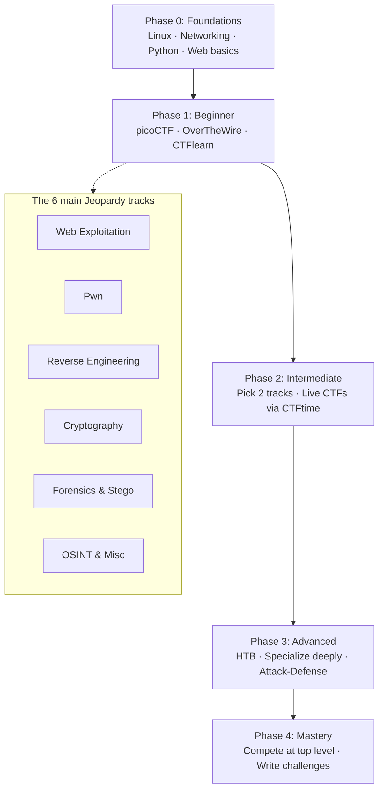

# CTF Tools and Resources — The Complete Roadmap

> A structured, beginner-to-advanced roadmap for getting into **Capture The Flag (CTF)** competitions — with category tracks, tools, learning resources, and practice platforms.

---

## Table of Contents

- [What is a CTF?](#what-is-a-ctf)
- [CTF Formats](#ctf-formats)
- [Roadmap Overview](#roadmap-overview)
- [Phase 0 — Foundations](#phase-0--foundations-prerequisites)
- [Phase 1 — Beginner](#phase-1--beginner-months-1--3)
- [Phase 2 — Intermediate](#phase-2--intermediate-months-3--6)
- [Phase 3 — Advanced](#phase-3--advanced-months-6--12)
- [Phase 4 — Mastery](#phase-4--mastery-year-1)
- [Category Tracks](#category-tracks)
  - [Web Exploitation](#1-web-exploitation)
  - [Binary Exploitation (Pwn)](#2-binary-exploitation-pwn)
  - [Reverse Engineering](#3-reverse-engineering)
  - [Cryptography](#4-cryptography)
  - [Digital Forensics](#5-digital-forensics)
  - [Steganography](#6-steganography)
  - [OSINT](#7-osint)
  - [Miscellaneous](#8-miscellaneous)
- [Practice Platforms](#practice-platforms-master-list)
- [Core Toolkit](#core-toolkit-install-these-first)
- [Your First 30 Days](#your-first-30-days-quick-start-plan)
- [How to Play Your First Live CTF](#how-to-play-your-first-live-ctf)
- [Books & Courses](#books--courses)
- [CTF Etiquette & Golden Rules](#ctf-etiquette--golden-rules)
- [Repository Structure](#repository-structure)
- [Contributing](#contributing)

---

## What is a CTF?

A **Capture The Flag** competition is a hands-on cybersecurity contest where you solve security challenges to recover hidden strings called **flags** (usually in the format `flag{...}`, `CTF{...}`, or `picoCTF{...}`). Each solved challenge earns points — the team with the most points wins.

CTFs are the fastest way to build **practical, job-ready security skills**: every challenge is a real exploit, a real binary, or a real cryptographic flaw you have to break yourself.

---

## CTF Formats

| Format | How it Works | Examples |
|---|---|---|
| **Jeopardy** | Independent challenges organized by category (Web, Pwn, Crypto, Forensics…). Solve in any order. Best format for learning. | picoCTF, DEF CON Quals |
| **Attack-Defense** | Each team defends its own vulnerable services while attacking everyone else's. Requires exploitation *and* patching skills. | DEF CON Finals, iCTF |
| **King of the Hill** | Teams fight for control of a target; holding it earns points over time. | Some HTB events |
| **Boot2Root / Mixed** | Full machine exploitation: recon → foothold → privilege escalation → flag. | Hack The Box, VulnHub boxes |

> **Tip:** Start with Jeopardy. It's the standard format for learning, and every category track below is built around it.

---

## Roadmap Overview



**Recommended learning order for a newcomer:** Web → Forensics/OSINT → Crypto → Reverse Engineering → Pwn.

Web and OSINT need the fewest prerequisites and give quick wins. Pwn has the steepest learning curve — save it for when your foundations are solid.

---

## Phase 0 — Foundations (Prerequisites)

*~2–4 weeks. Don't skip this — 90% of beginner frustration comes from missing foundations.*

### 0.1 Linux & the Command Line
Almost all CTFs assume a Linux environment.

- [ ] Install a VM (VirtualBox/VMware) with **Kali Linux** or Ubuntu — or use WSL2 on Windows
- [ ] Learn core commands: `ls`, `cd`, `cat`, `grep`, `find`, `file`, `strings`, `chmod`, `ssh`, `scp`, pipes & redirection
- [ ] Learn Bash scripting basics (loops, conditionals, variables)
- [ ] Resources: [OverTheWire: Bandit](https://overthewire.org/wargames/bandit/) (levels 0–15), [Linux Journey](https://linuxjourney.com/), [MIT — The Missing Semester](https://missing.csail.mit.edu/)

### 0.2 Networking Fundamentals
- [ ] OSI & TCP/IP models, TCP vs UDP, common ports (21, 22, 80, 443, 3306…)
- [ ] HTTP: requests, responses, headers, cookies, sessions, status codes
- [ ] DNS basics, subnetting basics, IP addressing
- [ ] Hands-on: `ping`, `traceroute`, `netcat` (`nc`), `curl`, `nmap`, packet sniffing with Wireshark

### 0.3 Programming
- [ ] **Python (essential):** variables, loops, functions, file I/O, `requests`, working with bytes & hex — the language of 90% of CTF scripts
- [ ] **C (for Pwn/RE):** pointers, memory layout, how programs compile and run
- [ ] **Read (not write):** PHP, JavaScript, SQL — enough to spot vulnerabilities in source code
- [ ] Regular expressions — invaluable for extracting flags

### 0.4 Environment Setup
- [ ] A notes system from day one (Markdown files, Obsidian, or a private GitHub repo)
- [ ] Git & GitHub basics — you'll publish write-ups later
- [ ] [CyberChef](https://gchq.github.io/CyberChef/) bookmarked — the swiss-army knife for encodings

**You're ready for Phase 1 when:** Bandit feels easy, you can write a Python script to brute-force or decode something, and HTTP requests don't confuse you.

---

## Phase 1 — Beginner (Months 1 – 3)

**Goal:** Get comfortable with the Jeopardy format and touch **every** category once.

- [ ] Create accounts: [picoCTF](https://picoctf.org/), [CTFlearn](https://ctflearn.com/), [CTFtime](https://ctftime.org/)
- [ ] Finish **OverTheWire: Bandit** (all levels)
- [ ] Solve **50+ beginner challenges** in picoGym, spread across all categories
- [ ] Try **OverTheWire: Natas** (web wargame, levels 0–10)
- [ ] Start a **notes file per category** — record every new trick, tool command, and flag format you meet
- [ ] After every stuck challenge, read 2–3 write-ups and **re-solve it yourself**

**Beginner milestones:**
- [ ] Decode anything thrown at you: Base64/32/58/85, hex, rot13, URL encoding, binary/ASCII
- [ ] Use `binwalk`, `exiftool`, `strings`, and `steghide` without looking them up
- [ ] Exploit your first SQL injection and IDOR
- [ ] Understand what a buffer overflow *is*, even if you can't exploit one yet

**You're ready for Phase 2 when:** you can score points in a beginner CTF unassisted and know which 1–2 categories you enjoy most.

---

## Phase 2 — Intermediate (Months 3 – 6)

**Goal:** Specialize. Pick **two tracks** and go deep; play your first live CTFs.

- [ ] Join or form a **team** (college club, Discord community, coworkers)
- [ ] Play your first **live CTFs** from [CTFtime](https://ctftime.org/) — weekend events are perfect
- [ ] Track-specific deep-dives (see [Category Tracks](#category-tracks)):
  - Web → [PortSwigger Web Security Academy](https://portswigger.net/web-security) (do the SQLi → Access Control → SSRF paths)
  - Pwn → [pwn.college](https://pwn.college/) + [Exploit Education Phoenix](https://exploit.education/phoenix/)
  - RE → [crackmes.one](https://crackmes.one/) (level 1–2 crackmes) + Ghidra tutorials
  - Crypto → [CryptoHack](https://cryptohack.org/) + [Cryptopals](https://cryptopals.com/) sets 1–2
  - Forensics → [CyberDefenders](https://cyberdefenders.org/) blue-team labs + Wireshark deep-dive
- [ ] Start **TryHackMe** learning paths (Pre-Security → Complete Beginner → Jr Penetration Tester)
- [ ] Write **public write-ups** after every CTF — even for challenges you didn't solve
- [ ] Build your personal **toolbox VM** with everything pre-installed and scripted

**You're ready for Phase 3 when:** you consistently score in the top 50% of weekend CTFs and can carry your team in at least one category.

---

## Phase 3 — Advanced (Months 6 – 12)

**Goal:** Become the person your team relies on for hard challenges.

- [ ] [Hack The Box](https://www.hackthebox.com/) — easy → medium standalone boxes, then active machines
- [ ] Deep specialization:
  - Web → SSRF→cloud, deserialization, JWT/OAuth attacks, race conditions, prototype pollution, web cache poisoning
  - Pwn → heap exploitation (tcache/fastbins/house of X), format strings, seccomp, v8/kernel pwn intro
  - RE → obfuscated/packed binaries, anti-debugging, VM-based protection, malware triage, [Flare-On](https://flare-on.com/)
  - Crypto → lattices, Coppersmith, ECC attacks, padding oracles, nonce reuse ([Cryptopals](https://cryptopals.com/) sets 5–8)
- [ ] Learn **Attack-Defense**: patching services, writing checkers, traffic analysis
- [ ] Compete in rated events: DEF CON Qualifiers, Google CTF, PlaidCTF, CSAW
- [ ] Automate everything: template pwntools scripts, one-command solve scripts, private team infra
- [ ] Do **junior bug bounties** or VDP programs on the side (HackerOne, Bugcrowd) to reinforce web skills

**You're ready for Phase 4 when:** your team finishes top 25% in mid-tier CTFs, and you've solved challenges tagged "hard" on HTB/RootMe.

---

## Phase 4 — Mastery (Year 1+)

**Goal:** Give back to the community and play at the highest level.

- [ ] **Author your own challenges** — you'll learn more building one crypto challenge than solving ten
- [ ] Organize or help run a CTF for your school/company/community
- [ ] Publish quality write-ups, tooling, or research — build your reputation
- [ ] Study CVEs and reproduce public exploits (1-day vulnerabilities)
- [ ] Contribute to open-source security tools (pwntools, GEF, CyberChef plugins…)
- [ ] Rank in the **CTFtime world leaderboard** with an active team
- [ ] Mentor beginners — teaching is the final level of understanding

---

## Category Tracks

The heart of Jeopardy CTFs. For each track: **what to learn → which tools → where to practice.**

---

### 1. Web Exploitation
*The most popular category — and the most job-relevant.*

#### Concepts (in learning order)
1. HTTP, cookies, sessions, robots.txt, directory brute-forcing
2. Client-side manipulations: DevTools, JS analysis, disabled fields
3. **Injection:** SQLi (union, blind, boolean/time-based), command injection, NoSQLi, SSTI, XXE
4. **XSS** (reflected/stored/DOM), CSRF, clickjacking
5. Broken authentication, session fixation, **IDOR**, weak JWTs
6. File inclusion (LFI/RFI), path traversal, unrestricted file upload
7. **SSRF**, open redirects, CRLF injection
8. Insecure deserialization, race conditions, business-logic flaws
9. Advanced: prototype pollution, web cache poisoning, HTTP request smuggling, OAuth misconfigurations

#### Tools
| Tool | Purpose |
|---|---|
| [Burp Suite](https://portswigger.net/burp) / [OWASP ZAP](https://www.zaproxy.org/) | Intercepting proxy — your #1 tool |
| Browser DevTools | Inspect JS, storage, network calls |
| [ffuf](https://github.com/ffuf/ffuf) / [gobuster](https://github.com/OJ/gobuster) + [SecLists](https://github.com/danielmiessler/SecLists) | Directory & parameter fuzzing |
| [sqlmap](https://sqlmap.org/) | Automated SQL injection |
| [jwt_tool](https://github.com/ticarpi/jwt_tool) | JWT analysis & attacks |
| curl | Quick manual requests |

#### Practice
- [PortSwigger Web Security Academy](https://portswigger.net/web-security) — the gold standard, free labs (start here)
- [OverTheWire: Natas](https://overthewire.org/wargames/natas/) — progressive web wargame
- [OWASP Juice Shop](https://owasp.org/www-project-juice-shop/) — intentionally vulnerable app
- [DVWA](https://github.com/digininja/DVWA), picoGym Web, [HackThisSite](https://www.hackthissite.org/)

---

### 2. Binary Exploitation (Pwn)
*The steepest, most rewarding track. Requires solid C + assembly basics.*

#### Concepts (in learning order)
1. C memory model: stack vs heap, calling conventions, registers
2. x86-64 assembly reading + debugging with GDB
3. Stack buffer overflows → controlling RIP → ret2win
4. Security mitigations: NX, Stack Canaries, ASLR, PIE, RELRO
5. Shellcoding, ret2libc, **ROP chains**, ret2csu
6. GOT overwrite, PLT, format string vulnerabilities
7. Heap fundamentals: tcache, fastbins, unsorted bin
8. Heap exploitation: use-after-free, double-free, House of Force/Orange techniques
9. Advanced: seccomp sandboxes, kernel pwn, browser/v8 exploitation

#### Tools
| Tool | Purpose |
|---|---|
| GDB + [pwndbg](https://github.com/pwndbg/pwndbg) or [GEF](https://github.com/hugsy/gef) | Enhanced debugging |
| [pwntools](https://docs.pwntools.com/) | Python exploit framework — essential |
| `checksec` | Inspect binary protections |
| [ROPgadget](https://github.com/JonathanSalwan/ROPgadget) / ropper | Find ROP gadgets |
| [Ghidra](https://github.com/NationalSecurityAgency/ghidra) / [IDA Free](https://hex-rays.com/ida-free/) | Decompilation |
| [libc.rip](https://libc.rip/) | Identify remote libc versions |
| [one_gadget](https://github.com/david942j/one_gadget) | One-shot exec call sites |

#### Practice
- [pwn.college](https://pwn.college/) — free university-grade course, start here ("Program Security")
- [Nightmare](https://guyinatuxedo.github.io/) — legendary guided pwn course
- [Exploit Education (Phoenix)](https://exploit.education/phoenix/), [Roppers Academy](https://www.roppers.org/)
- [ROP Emporium](https://ropemporium.com/), [pwnable.kr](http://pwnable.kr/), [pwnable.xyz](https://pwnable.xyz/)

---

### 3. Reverse Engineering
*Understand a binary without source code.*

#### Concepts (in learning order)
1. Assembly basics (x86/x64, later ARM), calling conventions
2. ELF/PE file formats, sections, symbols, imports
3. Static analysis: strings, disassembly, decompilation
4. Dynamic analysis: breakpoints, patching, tracing
5. Crackme / keygen logic, flag-checking routines
6. Anti-analysis: packing (UPX), obfuscation, anti-debugging
7. Language-specific: Java (bytecode/decompilers), .NET, Android APKs, Python `.pyc`
8. Intro malware analysis triage

#### Tools
| Tool | Purpose |
|---|---|
| [Ghidra](https://github.com/NationalSecurityAgency/ghidra) | Free NSA decompiler — start here |
| [IDA Free](https://hex-rays.com/ida-free/) / [Binary Ninja](https://binary.ninja/) | Industry disassemblers |
| [radare2](https://rada.re/) + [Cutter](https://cutter.re/) | CLI/GUI RE framework |
| [x64dbg](https://x64dbg.com/) | Windows debugger |
| GDB, `objdump`, `readelf`, `nm`, `strings`, `ltrace`, `strace` | Core utilities |
| [JADX](https://github.com/skylot/jadx), [Apktool](https://ibotpeaches.github.io/Apktool/), [dnSpyEx](https://github.com/dnSpyEx/dnSpy) | Android / .NET reversing |

#### Practice
- [crackmes.one](https://crackmes.one/) — thousands of crackmes by difficulty (start here)
- [reversing.kr](http://reversing.kr/), picoGym RE
- [Microcorruption](https://microcorruption.com/) — embedded RE wargame in the browser
- [Flare-On](https://flare-on.com/) (advanced), ["Reverse Engineering for Beginners" by Dennis Yurichev](https://beginners.re/) (free book)

---

### 4. Cryptography
*Breaking misused math. Heavy Python + a bit of number theory.*

#### Concepts (in learning order)
1. Encodings ≠ encryption: Base64 family, hex, URL-encoding, ASCII tables
2. Classical ciphers: Caesar, Vigenère, substitution, Rail Fence, frequency analysis
3. **XOR** — single-byte, repeating-key, known-plaintext attacks
4. Block ciphers: AES modes (ECB penguin, CBC bit-flipping, padding oracle)
5. Stream ciphers & RNG weaknesses: nonce/IV reuse, LCGs, bad seeds
6. **RSA:** factorable `n`, small/low `e`, common modulus, Wiener, Hastad broadcast, faulty exponents
7. Diffie-Hellman, small subgroup, MITM
8. Hashing: length extension, collisions
9. Advanced: lattices (LLL, Coppersmith), ECC attacks, side channels

#### Tools
| Tool | Purpose |
|---|---|
| [CyberChef](https://gchq.github.io/CyberChef/) | Encode/decode/hash everything |
| [dCode](https://www.dcode.fr/en) | Identify & solve classical ciphers |
| Python + [PyCryptodome](https://pycryptodome.readthedocs.io/), [SageMath](https://www.sagemath.org/) | Your actual weapons |
| [RsaCtfTool](https://github.com/RsaCtfTool/RsaCtfTool) | Automated RSA attacks |
| [FactorDB](https://factordb.com/) | Check if `n` has known factors |
| [hashcat](https://hashcat.net/hashcat/) / [John the Ripper](https://www.openwall.com/john/) | Hash cracking |

#### Practice
- [CryptoHack](https://cryptohack.org/) — progressive modern crypto challenges (start here)
- [The Cryptopals Crypto Challenges](https://cryptopals.com/) — build real attacks in code
- picoGym Crypto, RootMe Cryptanalysis

---

### 5. Digital Forensics
*Recover hidden evidence from files, disks, memory, and network traffic.*

#### Concepts (in learning order)
1. File types, magic bytes/headers, hex editors, fixing corrupted files
2. Metadata: EXIF, document properties, hidden comments
3. File carving & embedded archives (polyglot files, concatenated ZIPs)
4. **Network forensics:** PCAP analysis, HTTP object export, protocol filters
5. **Disk forensics:** images, partitions, deleted file recovery
6. **Memory forensics:** processes, injected code, dumping secrets from RAM
7. Log analysis, timelines, USB/device artifacts
8. Password-protected archives & wordlist attacks

#### Tools
| Tool | Purpose |
|---|---|
| [Wireshark](https://www.wireshark.org/) / `tshark` | PCAP analysis |
| `binwalk`, `foremost`, `scalpel` | File carving |
| `exiftool`, `file`, `xxd` / hex editors | Metadata & bytes |
| [Volatility 3](https://github.com/volatilityfoundation/volatility3) | Memory forensics |
| [Autopsy](https://www.sleuthkit.org/) / Sleuth Kit | Disk image investigation |
| `fcrackzip`, John the Ripper | Archive password cracking |

#### Practice
- picoGym Forensics + [CyberDefenders](https://cyberdefenders.org/) (realistic blue-team labs — start here)
- [MemLabs](https://github.com/stuxnet999/MemLabs) — memory forensics scenarios
- RootMe Forensic, HTB Sherlocks

---

### 6. Steganography
*Often bundled with Forensics — hiding data inside innocent-looking files.*

#### Concepts
- Data appended after EOF, hidden fields, invisible Unicode/whitespace
- **LSB** encoding in images (per-channel, per-plane)
- Palette & alpha-channel tricks, animated GIF frames
- Audio stego: spectrograms, morse, SSTV, DTMF tones
- Video frame extraction, QR/barcode chains

#### Tools
| Tool | Purpose |
|---|---|
| `steghide`, `zsteg`, `stegseek` | PNG/BMP/JPG stego analysis |
| [StegSolve](https://github.com/eugenekolo/sec-tools/tree/master/steganography/stegsolve) (or [Aperi'Solve](https://www.aperisolve.com/)) | Visual plane filtering |
| `pngcheck`, `exiftool` | Image integrity & metadata |
| Audacity, [Sonic Visualiser](https://www.sonicvisualiser.org/), RX-SSTV | Audio analysis |
| `zbarimg` / online QR readers | Barcodes & QR codes |

#### Practice
- picoGym & CTFlearn steganography challenges, OverTheWire Krypton (basics), any weekend CTF "misc/forensics" board

---

### 7. OSINT
*Find public information others think is hidden.*

#### Concepts
- Username/email/phone enumeration across platforms
- Google dorking (Google Hacking Database)
- Image analysis: reverse search, EXIF geolocation, landmark identification
- Social media investigation, archived pages, breach data
- Domain/DNS intelligence: WHOIS, subdomains, certificate transparency

#### Tools
| Tool | Purpose |
|---|---|
| Search engines + dorks (`site:`, `filetype:`, `inurl:`) | Your primary weapon |
| [Sherlock](https://github.com/sherlock-project/sherlock) | Username hunting across social networks |
| [Shodan](https://www.shodan.io/) | Internet-connected device search |
| [Wayback Machine](https://web.archive.org/), [TinEye](https://tineye.com/), Google Lens | Archives & reverse image search |
| `exiftool`, Google Maps/Earth, [OSINT Framework](https://osintframework.com/) | Analysis & curated links |

#### Practice
- [OSINT Dojo](https://www.osintdojo.com/) — ranked OSINT challenges (start here)
- TryHackMe: *Sakura Room*, *OhSINT* — GeoGuessr (seriously, it teaches geolocation)
- [Bellingcat challenges](https://challenge.bellingcat.com/), Trace Labs events

---

### 8. Miscellaneous
*The "everything else" bucket — often puzzle-heavy.*

- **Jail/sandbox escapes:** Python pyjails, restricted shells, quirky Bash
- **Esoteric languages:** Brainfuck, Malbolge, Piet — keep decoders handy
- **Programming challenges:** parse 10k lines, solve a maze, automate a game → script it with pwntools/socket
- **QR/barcode puzzles,** audio puzzles, chess/logic puzzles
- Later: **blockchain** (smart contract exploits), **hardware** (UART/SPI/I2C), **AI/LLM** prompt-injection challenges

---

## Practice Platforms (Master List)

| Platform | Focus | Difficulty | Cost |
|---|---|---|---|
| [picoCTF / picoGym](https://picoctf.org/) | All categories, year-round | Beginner | Free |
| [OverTheWire](https://overthewire.org/wargames/) | Linux (Bandit), Web (Natas), Crypto (Krypton) | Beginner | Free |
| [CTFlearn](https://ctflearn.com/) | All categories | Beginner | Free |
| [TryHackMe](https://tryhackme.com/) | Guided rooms & paths | Beginner | Freemium |
| [PortSwigger Academy](https://portswigger.net/web-security) | Web | Beginner → Advanced | Free |
| [pwn.college](https://pwn.college/) | Pwn, RE, systems security | Beginner → Advanced | Free |
| [CryptoHack](https://cryptohack.org/) | Cryptography | Intermediate | Free |
| [Exploit Education](https://exploit.education/) | Pwn (local VMs) | Intermediate | Free |
| [RootMe](https://www.root-me.org/) | 400+ challenges, all categories | Intermediate | Freemium |
| [Cryptopals](https://cryptopals.com/) | Crypto programming | Intermediate → Advanced | Free |
| [crackmes.one](https://crackmes.one/) | Reverse engineering | Intermediate → Advanced | Free |
| [ROP Emporium](https://ropemporium.com/) | ROP technique drills | Intermediate → Advanced | Free |
| [pwnable.kr](http://pwnable.kr/) / [pwnable.xyz](https://pwnable.xyz/) | Pwn wargames | Intermediate → Advanced | Free |
| [RingZer0 CTF](https://ringzer0ctf.com/) | All categories | Intermediate → Advanced | Free |
| [247CTF](https://247ctf.com/) | Year-round jeopardy | Intermediate → Advanced | Free |
| [Microcorruption](https://microcorruption.com/) | Embedded RE | Intermediate | Free |
| [Hack The Box](https://www.hackthebox.com/) | Realistic boxes & challenges | Advanced | Freemium |
| [CyberDefenders](https://cyberdefenders.org/) | Blue team / DFIR | Intermediate → Advanced | Freemium |
| [VulnHub](https://www.vulnhub.com/) | Offline vulnerable VMs | Advanced | Free |
| [CTFtime](https://ctftime.org/) | The calendar — find **live** CTFs, ratings, write-ups | All | Free |

---

## Core Toolkit (Install These First)

**One-time setup (~1 hour), then grow your toolbox per track:**

1. **Kali Linux** or Ubuntu VM (or WSL2) — [kali.org](https://www.kali.org/)
2. **Python 3** + `pip`, plus: `pwntools pycryptodome requests`
3. **GDB + [pwndbg](https://github.com/pwndbg/pwndbg)**
4. **[Burp Suite Community](https://portswigger.net/burp)**
5. **[Ghidra](https://github.com/NationalSecurityAgency/ghidra)**
6. **[Wireshark](https://www.wireshark.org/)**
7. **nmap, netcat, curl, sqlmap, ffuf, gobuster** + [SecLists](https://github.com/danielmiessler/SecLists)
8. **binwalk, exiftool, steghide, zsteg, foremost**
9. **[John the Ripper](https://www.openwall.com/john/)** or [hashcat](https://hashcat.net/hashcat/)
10. Browser bookmarks: [CyberChef](https://gchq.github.io/CyberChef/), [dCode](https://www.dcode.fr/en), [Factordb](https://factordb.com/), [libc.rip](https://libc.rip/)

---

## Your First 30 Days (Quick-Start Plan)

| Week | Focus | Concrete Tasks |
|---|---|---|
| **Week 1** | Environment + Linux | Install VM; OverTheWire **Bandit 0→15**; learn `grep`/`strings`/`file`; write 3 tiny Python scripts |
| **Week 2** | Encodings + Forensics | All BaseXX/hex encodings by heart; 15 picoGym Forensics/General challenges; learn CyberChef, `binwalk`, `exiftool` |
| **Week 3** | Web | Finish Bandit; **Natas 0→10**; first SQLi on PortSwigger Academy; Burp Suite basics |
| **Week 4** | Crypto + first CTF | 10 picoGym Crypto challenges; XOR attacks; play a **live weekend CTF** from CTFtime with a team; write your first write-up |

---

## How to Play Your First Live CTF

1. Go to [CTFtime.org](https://ctftime.org/) → **Upcoming Events** → pick a beginner-friendly weekend event (look for low difficulty/weight ratings).
2. Register your team on the event's platform (and its Discord — hints are often dropped there).
3. When it starts: register accounts, read the **rules** (flag format, scoring, attack scope).
4. Triage the board: everyone grabs 1–2 challenges in their strongest categories; aim for **first bloods on easy challenges** to build confidence.
5. Apply the **30-minute rule**: stuck for 30–45 min? Write down what you tried, switch challenge, come back later.
6. After the event: read top-3 teams' write-ups for every challenge you *didn't* solve. Re-solve them. Update your notes.
7. Post your own write-up on GitHub/CTFtime — this is how you get noticed and invited to better teams.

---

## Books & Courses

**Books**
- *Hacking: The Art of Exploitation* — Jon Erickson (pwn fundamentals)
- *The Web Application Hacker's Handbook* — Stuttard & Pinto (web bible)
- *Serious Cryptography* — Jean-Philippe Aumasson
- *Practical Binary Analysis* — Dennis Andriesse
- *The Ghidra Book* — Chris Eagle & Kara Nance
- *Practical Malware Analysis* — Sikorski & Honig (RE)

**Free courses / guides**
- [The CTF Field Guide (Trail of Bits)](https://trailofbits.github.io/ctf/)
- [CTF 101](https://ctf101.org/) — category-by-category primer
- [Roppers Computing Fundamentals](https://www.roppers.org/)
- [Irvon Stone's CTF Notes](https://ir0nstone.gitbook.io/notes)
- [awesome-ctf](https://github.com/apsdehal/awesome-ctf) — the community-curated mega list

**YouTube channels**
- [LiveOverflow](https://www.youtube.com/c/LiveOverflow) — beautifully explained pwn/RE concepts
- [John Hammond](https://www.youtube.com/@_JohnHammond) — daily CTF walkthroughs
- [IppSec](https://www.youtube.com/@ippsec) (+ [ippsec.rocks](https://ippsec.rocks/) search engine) — HTB methodology
- [PwnFunction](https://www.youtube.com/@PwnFunction) — animated web vulnerability explainers
- [stacksmashing](https://www.youtube.com/@stacksmashing) — hardware & low-level

---

## CTF Etiquette & Golden Rules

- **Never attack the CTF infrastructure itself** — only the targets explicitly in scope. Automating scans against the platform = ban.
- **Don't share flags or solutions** while an event is live.
- **Brute force sparingly** — shared challenge hosts have limited resources (and rate limits).
- Credit authors and teams when re-using techniques in write-ups.
- **Document everything.** Future-you is your best teammate.
- Challenges are solvable — if it feels impossible, you're missing a piece of information. Re-read *everything*: description, filenames, headers, comments.
- Googling is the skill. `"SQL injection WAF bypass cheat sheet"` beats raw knowledge.
- Read write-ups *after* trying — understanding is a muscle.

---

## Repository Structure

This repository will grow in the following layout:

```
CTF-tools-and-resources/
├── README.md            ← This roadmap (start here)
├── notes/               ← Category-wise notes & cheat sheets
├── tools/               ← Tool installation guides & usage snippets
├── resources/           ← Curated books, courses, videos & links
├── practice/            ← Platform guides & challenge walkthroughs
└── writeups/            ← Solved challenge write-ups from live CTFs
```

> Sections are being added progressively — star the repo to follow along.

---

## Contributing

Contributions are welcome! Whether it's a new note, a better explanation, a fresh tool, or a write-up:

1. Fork the repository
2. Add your content to the relevant folder (keep the existing format)
3. Open a Pull Request with a short description

---

*Made for the CTF community. Flags are earned, never given.*
